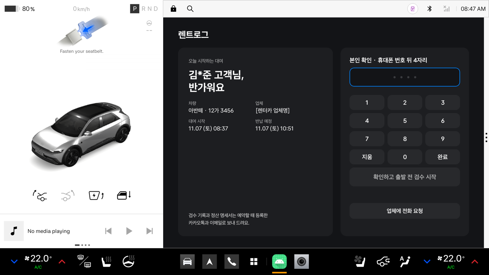
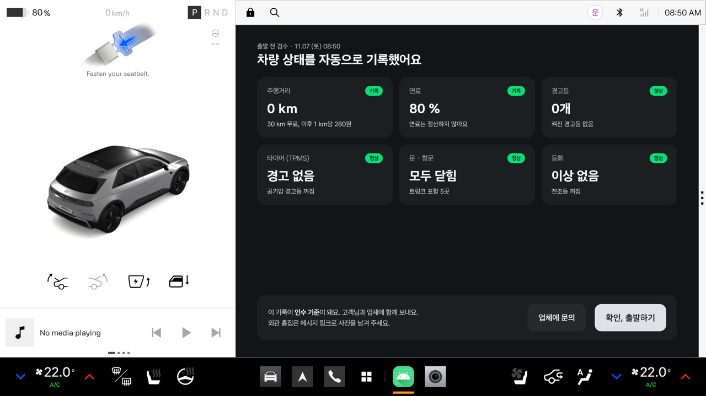
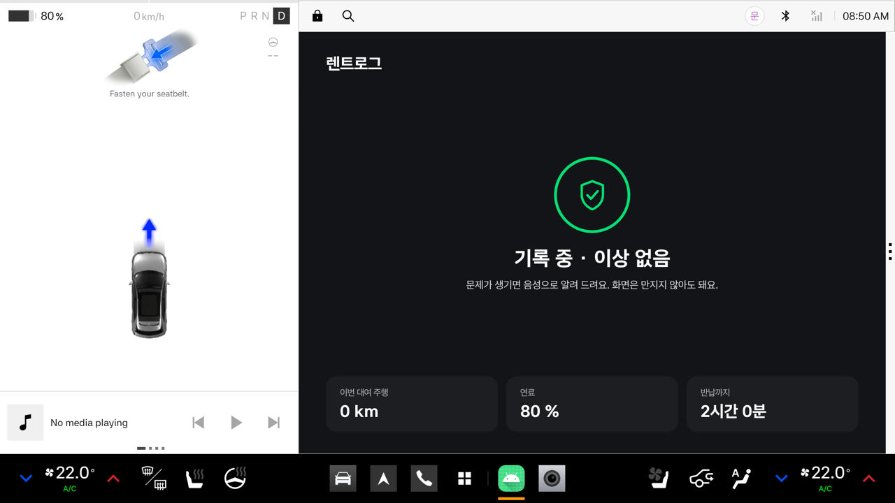
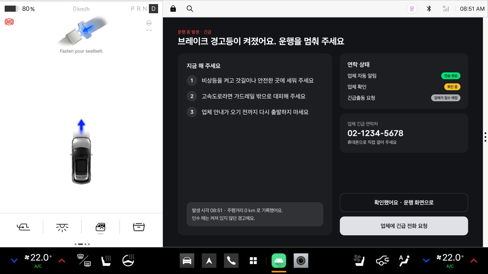
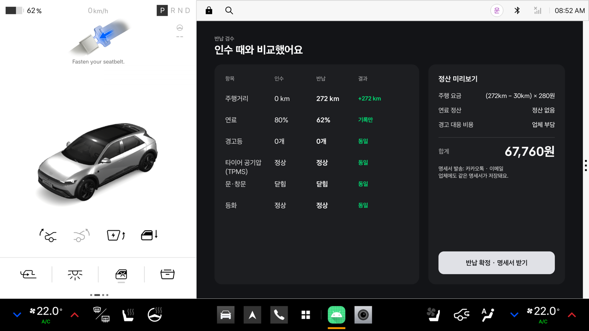
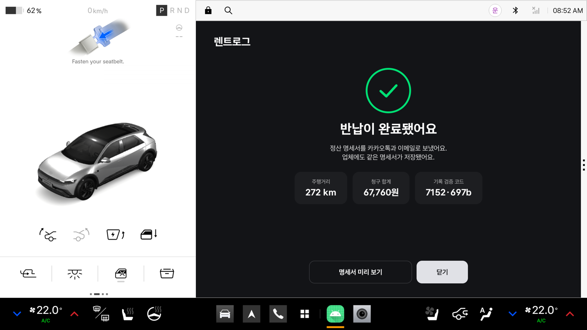

# 렌트로그 (RentLog) 프로토타입


## 앱 이름 및 한 줄 소개
Pleos Connect 차량용 **렌터카 인수·운행·반납 기록 앱**입니다. 차량 신호(주행거리, 배터리, 문·창문, 경고등)를 자동으로 기록해서 인수 때와 반납 때를 비교하고, 요금 정산과 명세서까지 만들어 줍니다. 서버는 앱 안의 가짜 서버(`FakeBackend`)이고, 실제 서버는 아직 연결하지 않았습니다.

### 화면 흐름

F-01 대여 시작·본인 확인 → F-02 출발 전 검수 → F-03 주행 중 → (F-04 주의 경고 → F-05 정차 후 대응 / F-10 긴급 경고) → F-06 반납 전 안내 → F-07 반납 검수 → F-11 반납 완료 → 명세서. 오류 화면은 F-08(예약 없음 · 확인 잠김 · 연결 끊김)입니다.
| F-01 본인 확인 | F-02 출발 전 검수 | F-03 주행 중 |
|---|---|---|
|  |  |  |

| F-10 긴급 경고 | F-07 반납 검수 | F-11 반납 완료 |
|---|---|---|
|  |  |  |\

## 실행 방법

### 1. 프로젝트 열기
1. Android Studio 최신 버전에서 이 폴더를 엽니다. Gradle Sync가 끝날 때까지 기다립니다.
2. SDK Manager에서 **Android 37** SDK와 Platform-Tools, Emulator를 설치합니다.
3. `local.properties`는 Android Studio가 자동으로 만듭니다(커밋하지 않습니다).

### 2. Pleos Connect 에뮬레이터 켜기
1. Device Manager에서 **`Pleos_Connect_v2.1.0`** AVD를 준비합니다(Pleos 제공 시스템 이미지. RAM 4GB 이상).
2. AVD 오른쪽 ▼ 메뉴 → **Cold Boot Now**로 켭니다. 일반 Run으로 켜면 이전 상태(주행거리 등)가 남을 수 있습니다.
3. 터미널로 켜려면: `~/Library/Android/sdk/emulator/emulator -avd Pleos_Connect_v2.1.0 -no-snapshot-load`
4. 일반 폰 에뮬레이터(예: `Medium_Phone`)에서도 앱은 실행됩니다. 이때는 Pleos 서비스가 없어서 **시뮬레이터 값으로 자동 전환**됩니다(데모 패널 사용).

### 3. 앱 설치·실행
- Android Studio에서 Run ▶, 또는 터미널에서:
```bash
./gradlew assembleDebug
adb install -r app/build/outputs/apk/debug/app-debug.apk
adb shell am start -n com.example.pleosrantlog/.MainActivity
```
- 앱 안의 가짜 서버는 앱을 다시 시작하면 초기화됩니다. **본인 확인 번호는 `1234`**, 대상 차량 번호는 `12가3456`입니다.

### 릴리즈 APK 만들기
제출용 APK는 `apk/팀명_앱이름_release.apk`에 둡니다(파일명은 `app/build.gradle.kts`의 `releaseApkName`).
1. 키스토어를 만듭니다(처음 한 번). Android Studio **Build > Generate Signed App Bundle or APK > APK > Create new...**에서 만들고 창은 닫아도 됩니다. 저장 위치는 저장소 **밖**을 권장합니다.
2. 프로젝트 루트에 `keystore.properties`를 만듭니다. **커밋 금지(공개 저장소)**, `.gitignore`에 등록되어 있습니다.
   ```properties
   storeFile=D:/keys/rentlog-release.jks
   storePassword=비밀번호
   keyAlias=별칭
   keyPassword=비밀번호
   ```
3. 빌드합니다. 서명된 APK가 `apk/` 폴더에 복사됩니다(Android Studio Gradle 패널 **app > Tasks > build > releaseApk**도 같음).
   ```bash
   ./gradlew releaseApk
   ```
4. 에뮬레이터에서 확인합니다. 디버그 앱이 설치되어 있으면 서명이 달라 먼저 지워야 합니다.
   ```bash
   adb uninstall com.example.pleosrantlog
   adb install -r apk/팀명_렌트로그_release.apk
   ```
- 키스토어 파일과 비밀번호를 잃어버리면 같은 앱으로 업데이트할 수 없으니 팀 내에서 안전하게 보관하세요.

### 4. Virtual Console로 차량 신호 조작
Pleos Connect 에뮬레이터는 웹 기반 Virtual Console(8088 포트)로 차량 값을 바꿉니다.
```bash
adb forward tcp:8088 tcp:8088
open http://127.0.0.1:8088/      # 이 탭을 열어 두어야 콘솔이 활성화됩니다
```
- 브라우저 페이지를 **닫지 마세요.** 열려 있는 동안만 콘솔이 동작합니다(자동화 스크립트는 대신 하트비트를 보냅니다).
- 시연 전 초기값: Odometer 12340 km, Battery SOC 80 %, Gear P, Telltales Off, 문·트렁크·프렁크 닫힘
- 명령줄로 바꾸는 방법(curl)은 [`docs/시연_시나리오.md`](docs/시연_시나리오.md)에 있습니다.
- **주의**
  - 주행거리는 **줄일 수 없습니다.** 처음부터 다시 하려면 Cold Boot 하세요.
  - **비행기 모드를 켜면 콘솔이 먹통**이 됩니다. 연결 끊김 시연은 영상의 마지막에 하고, 이후 Cold Boot로 복구합니다.
  - 전기차라 화면의 "연료"는 배터리 SOC입니다. 브레이크 경고등이 없어 **ABS를 긴급 경고**로 씁니다.

## 테스트 환경 및 필요한 설정

| 항목 | 버전 |
|---|---|
| Kotlin | 2.2.10 |
| Android Gradle Plugin | 9.5.1 |
| Jetpack Compose BOM | 2026.02.01 (Material3) |
| compileSdk / targetSdk / minSdk | 37 / 37 / 28 |
| Java 타깃 | 11 (Gradle 툴체인이 자동으로 JDK를 받습니다. Android Studio 내장 JDK 권장) |
| 코루틴 / ViewModel | 1.9.0 / 2.8.7 |

**Pleos SDK** (`gradle/libs.versions.toml`)

| 라이브러리 | 버전 | 용도 |
|---|---|---|
| `ai.pleos.playground:Vehicle` | 2.3.2 | 주행거리·배터리·기어·문·창문·경고등(telltale) 읽기 |
| `ai.pleos.playground:TextToSpeech` | 3.3.1 | 음성 안내 |
| `ai.pleos.playground:NaviHelper` | 3.0.5 | 반납 장소 내비 호출 |

- 저장소: `https://nexus-playground.pleos.ai/repository/maven-releases/` (`settings.gradle.kts`에 이미 등록됨)
- 권한(`AndroidManifest.xml`): `CAR_DRIVE`, `CAR_ENERGY`, `CAR_SAFETY`, `PRIVATE_CAR_SAFETY`, `CAR_INFO`, `CAR_DOORS`, `CAR_WINDOWS`, `CAR_LIGHTS`, `TTS_SERVICE`, `NAVI_ROUTE_SEARCH`
- `PRIVATE_CAR_SAFETY`는 경고등 읽기에 필요합니다. **스토어 제출 시 Pleos App Market 사전 승인이 필요합니다.**

### 테스트 방법

| 종류 | 명령 | 소요 | 비고 |
|---|---|---|---|
| 단위 테스트 | `./gradlew testDebugUnitTest` | 수 초 | 91개. 에뮬레이터 불필요 |
| 계측 테스트 | `./gradlew connectedDebugAndroidTest` | 약 1분 | 에뮬레이터 필요, **온라인 상태에서 실행**. 끝나면 앱이 지워지니 `adb install -r`로 다시 설치 |
| E2E | `python3 scripts/e2e_test.py [--only lock,blockers,flow,tire] [--out DIR]` | 약 6분 | Cold Boot 직후, 포트 포워딩 후 실행. 실패 시 종료코드 1 |
| 자동 시연 | `python3 scripts/demo_autoplay.py [--pause 4] [--skip-lock]` | 약 3분 | 영상 녹화용 |

- 스크립트는 Python 3 표준 라이브러리만 씁니다. adb는 `$ADB` → `$ANDROID_HOME` → `PATH` → 기본 SDK 위치 순서로 찾고, 여러 기기가 있으면 `ANDROID_SERIAL`을 지정하세요. 화면 좌표(`APP_X`, `APP_Y`)는 Pleos Connect AVD 기준입니다.
- 에뮬레이터는 `TIRE_PRESSURE`를 지원하지 않아 타이어 kPa 항목은 SKIP으로 나옵니다(TPMS 경고등으로 대신 검증).
- 최신 결과: [`docs/테스트_결과.md`](docs/테스트_결과.md)

## APK 파일 위치 또는 GitHub Release 링크
APK 파일 위치 : apk/팀명_앱이름_release.apk
